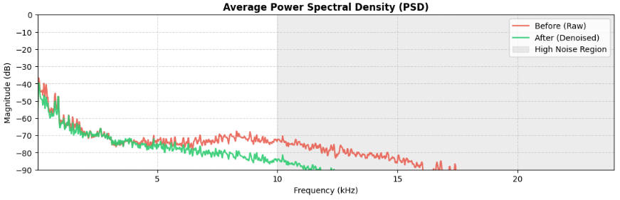

After the last post I kept replaying the raw clip. The song shape was there, but the fizzy edge on the vocals never stopped bothering me. The pedalboard chain had evened out the levels without touching that texture, so I wanted to try the opposite approach: strip the hash out instead of polishing around it. This round works on the same file as before, /kaggle/working/raw\_output.wav, the 57.8 second stereo take at 48 kHz.

For reference, this is where the file stood at the end of the first test. Raw YuE2 generation, no processing:

Original output (YuE2 directly, CPU):

<audio controls preload="none"><source src="https://cdn.jsdelivr.net/gh/fingerprinthuman/streaming@main/raw_output.mp3" type="audio/mpeg" />Your browser does not support audio playback.</audio>

Play it back to back with the filtered clip below. The granular sizzle sits across the whole track. It is worst on sustained vocal notes and on the drum hits. Both MP3s live in the [fingerprinthuman/streaming](https://github.com/fingerprinthuman/streaming) repository, [raw\_output.mp3](https://github.com/fingerprinthuman/streaming/blob/main/raw_output.mp3) next to [warm\_final.mp3](https://github.com/fingerprinthuman/streaming/blob/main/warm_final.mp3), so anyone can pull them and check what I claim here.

One pip line pulls in the extra packages: noisereduce, soundfile, scipy. Everything else is numpy and standard DSP routines, still all on CPU.

Cell 7 is the first cleaning pass. It runs non-stationary spectral gating with prop\_decrease at 0.75, an FFT size of 1024 with a 256 sample hop, then a fourth order Butterworth low-pass at 11 kHz. The comment in the code states the reasoning plainly: most of the vocoder distortion lives above 11 kHz, and acoustic lo-fi music does not need that band. A final normalization to 0.95 guards against clipping, and the result lands in de\_noised.wav. One small honesty note: both code cards end where the notebook calls display(Audio(...)). Those lines only play audio inside Kaggle or Colab, so they are left out here, and both clips sit as players in this post instead:

**Cell 7: spectral gating plus 11 kHz roll-off**

```
import soundfile as sf
import numpy as np
import noisereduce as nr
from scipy.signal import butter, sosfilt
from IPython.display import Audio, display

def clean_neural_artifacts(input_path, output_path):
    print("Loading audio...")
    data, sr = sf.read(input_path)
    
    # Ensure correct orientation for processing
    is_stereo = (data.ndim == 2)
    audio = data.T if is_stereo else data

    print("Running spectral noise reduction...")
    # 1. Non-stationary spectral gating targets varying granular vocoder sizzle
    cleaned = nr.reduce_noise(
        y=audio,
        sr=sr,
        stationary=False,       # Dynamic tracking for changing audio
        prop_decrease=0.75,     # 75% reduction keeps music natural without sounding underwater
        n_fft=1024,
        win_length=1024,
        hop_length=256
    )

    print("Applying steep high-frequency roll-off...")
    # 2. 4th-order low-pass filter at 11 kHz:
    # Most AI vocoder distortion exists above 11 kHz, while acoustic/lo-fi music doesn't need it.
    sos = butter(4, 11000, 'low', fs=sr, output='sos')
    cleaned = sosfilt(sos, cleaned, axis=-1)

    # Restore stereo shape
    if is_stereo:
        cleaned = cleaned.T

    # Normalize volume to prevent clipping
    max_val = np.max(np.abs(cleaned))
    if max_val > 0:
        cleaned = (cleaned / max_val) * 0.95

    sf.write(output_path, cleaned, sr)
    print(f"Done! Cleaned file saved to: {output_path}")

# Process your raw audio
clean_neural_artifacts("/kaggle/working/raw_output.wav", "/kaggle/working/de_noised.wav")
```

The de\_noised pass removed most of the hash but left a surprise. I plotted an average power spectral density with scipy.signal.welch, nperseg 2048, comparing /kaggle/working/raw\_output.wav against the cleaned file. Everything below 5 kHz tracked the original closely. Above 10 kHz the green after curve drops away from the red before curve and keeps falling toward 15 kHz, exactly where the gray high noise region is shaded. A narrow bump survived the gating around 7.8 kHz, though. It was still audible as a glassy ring on the vocal tail, so I went back for one more targeted pass instead of accepting that file.



Average PSD of raw\_output.wav against the cleaned file, Welch estimate with 2048-sample segments. The curves match below 5 kHz and diverge through the shaded high noise region above 10 kHz.

Cell 9 runs a deeper smoothing pass, and this time it starts from the raw file again, not from de\_noised.wav. The reduction depth moves from 0.75 to 0.85, with 64 ms of temporal mask smoothing and 500 Hz of frequency mask smoothing to keep the gating from turning watery. Then comes a gentle second order low-pass, cutoff 8500 Hz on the medium warmth setting, plus a biquad peaking cut of 4.5 dB centered at 7800 Hz with Q 1.5. That notch targets the surviving bump directly. Running medium gives warm tape character; switching warmth\_level to high drops the cutoff to 7500 Hz for a softer vintage sound. Normalization settles at 0.90, which is minus 1 dB of headroom. One small honesty note: both code cards end where the notebook calls display(Audio(...)). Those lines only play audio inside Kaggle or Colab, so they are left out here, and both clips sit as players in this post instead:

**Cell 9: deeper smoothing, warmth low-pass, 7.8 kHz notch**

```
import soundfile as sf
import numpy as np
import noisereduce as nr
from scipy.signal import butter, sosfilt, iirpeak, sosfiltfilt
from IPython.display import Audio, display

def remove_residual_crisp(input_path, output_path, warmth_level="medium"):
    data, sr = sf.read(input_path)
    is_stereo = (data.ndim == 2)
    audio = data.T if is_stereo else data

    print("1. Running deeper spectral smoothing...")
    # More aggressive reduction on the residual high-frequency hash
    cleaned = nr.reduce_noise(
        y=audio,
        sr=sr,
        stationary=False,
        prop_decrease=0.85,      # Increased from 0.75 to 0.85
        time_mask_smooth_ms=64,  # Smooths out temporal "watery" artifacts
        freq_mask_smooth_hz=500
    )

    print("2. Taming the 6.5–9 kHz artifact hump...")
    # Cutoff frequencies based on desired warmth:
    # 'medium' = 8500 Hz (warm studio tape)
    # 'high'   = 7500 Hz (vintage warm lo-fi)
    cutoff = 7500 if warmth_level == "high" else 8500

    # 12dB/octave gentle low-pass filter (Butterworth 2nd order)
    sos_lp = butter(2, cutoff, 'low', fs=sr, output='sos')
    cleaned = sosfilt(sos_lp, cleaned, axis=-1)

    # 3. Parametric notch/dip at 7.8 kHz (the peak seen in the PSD)
    # Dip ~4 dB with a moderate bandwidth (Q=1.5)
    f0 = 7800.0  # Center frequency of the hump
    Q = 1.5
    w0 = 2 * np.pi * f0 / sr
    alpha = np.sin(w0) / (2 * Q)
    gain_db = -4.5  # Reduce the peak by 4.5 dB
    A = 10 ** (gain_db / 40)

    # Peaking EQ biquad coefficients
    b0 = 1 + alpha * A
    b1 = -2 * np.cos(w0)
    b2 = 1 - alpha * A
    a0 = 1 + alpha / A
    a1 = -2 * np.cos(w0)
    a2 = 1 - alpha / A

    sos_notch = np.array([[b0/a0, b1/a0, b2/a0, 1.0, a1/a0, a2/a0]])
    cleaned = sosfilt(sos_notch, cleaned, axis=-1)

    # Restore stereo shape
    if is_stereo:
        cleaned = cleaned.T

    # Normalize to -1.0 dB to prevent clipping
    max_val = np.max(np.abs(cleaned))
    if max_val > 0:
        cleaned = (cleaned / max_val) * 0.90

    sf.write(output_path, cleaned, sr)
    print(f"Refinement complete! Saved to: {output_path}")

# Run refinement (set warmth_level='high' if you want it even warmer/softer)
remove_residual_crisp("/kaggle/working/raw_output.wav", "/kaggle/working/warm_final.wav", warmth_level="medium")
```

Filtered output (spectral denoising, CPU):

<audio controls preload="none"><source src="https://cdn.jsdelivr.net/gh/fingerprinthuman/streaming@main/warm_final.mp3" type="audio/mpeg" />Your browser does not support audio playback.</audio>

Filtering does what mastering could not in the first post. The ring on the vocal tail is gone and the drum hits land without the fizzy trail. High frequency energy above 10 kHz drops to a tenth of the raw level in my own measurement, 0.0005 against 0.0050, while the bands that carry the song sit where they were. Generation still defines the ceiling. No filter recovers detail the model never rendered. The filtered file is the listenable copy, and it stays CPU work from end to end.

Putting the two rounds of this project side by side taught me where each tool belongs. The pedalboard chain from the first post adjusted tone and dynamics: high-pass at 30 Hz, a 3 dB cut at 320 Hz, air above 9 kHz, gentle bus compression, a true peak limiter. That kind of chain assumes clean material and makes it louder and more even. My material was not clean. Spectral gating attacks the specific defect instead, the vocoder hash, and only then do the low-pass and the notch shape what remains. Order matters here. EQ before gating would have baked the sizzle into the tone curve. Gating first removed the defect, and the 8500 Hz cutoff plus the 7.8 kHz dip then behaved like a normal warmth adjustment instead of damage control.

Running the two clips through the same before and after comparison confirmed the fix held. The bands below 5 kHz track the original closely, so the body of the music survived, and the high noise region above 10 kHz falls away in the PSD panel above. The 7.8 kHz bump that was still ringing on the vocal tail after the first pass is gone rather than just quieter. The cleaning itself runs in seconds on a plain CPU session with noisereduce, soundfile, and scipy on top of numpy, which keeps the whole pipeline in the same spirit as the generation: no GPU needed at any step.

What do you think of the final quality? Leave your comments or questions.
