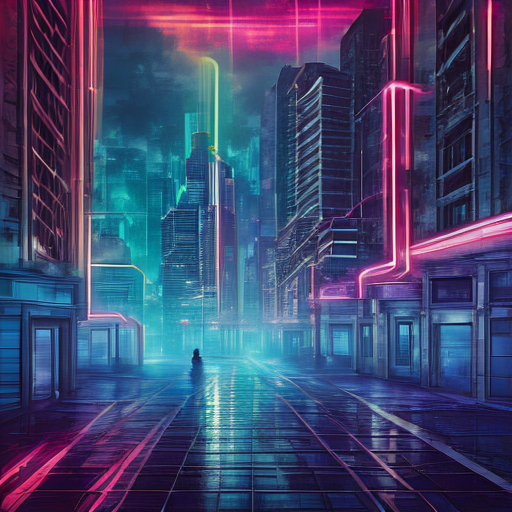
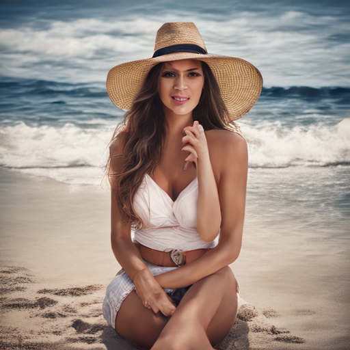
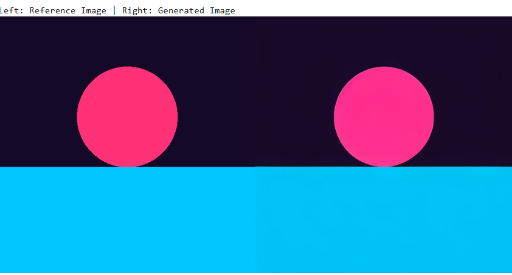

In Colab or Kaggle, when you run out of free GPU time you feel blocked. I assumed image generation without a GPU was impossible, or at least so slow it was not worth trying. So I treated this as a quick test of that assumption: switch the Colab runtime to CPU, run stabilityai/sd-turbo, and see what happens. It returned an image in a few seconds, and the result was not that bad. That surprised me enough to write it up.

The notebook is at experiments/image\_gem\_cpu/image\_gen\_cpu.ipynb. It has two cells. The first one installs the packages:

**Cell 1 — install**

```
%%bash
pip install -q diffusers transformers accelerate torch
```

The second cell loads the pipeline in float32 for CPU and runs one inference step with guidance turned off, which is what the model card recommends for this checkpoint:

**Cell 2 — generate on CPU**

```
import torch
from diffusers import AutoPipelineForText2Image
from IPython.display import Image as IPImage, display

pipe = AutoPipelineForText2Image.from_pretrained(
    "stabilityai/sd-turbo",
    torch_dtype=torch.float32
)

image_prompt = (
    "cinematic retro synthwave album cover, neon grid city, "
    "cyberpunk aesthetic, moody lighting, highly detailed, vibrant colors"
)

print("Generating image on CPU (1 step)...")

result = pipe(
    prompt=image_prompt,
    num_inference_steps=1,
    guidance_scale=0.0
)

image = result.images[0]
image.save("cover_art.png")

display(IPImage("cover_art.png", width=512))
```

The output from that run is saved in the experiments folder as city.png:



Generated on CPU in 1 step: neon grid city. Better than I expected.

For this kind of geometry it was enough. A dark grid and a skyline hide a lot of mistakes. SD-Turbo is a distilled version of Stable Diffusion 2.1, trained with Adversarial Diffusion Distillation for sampling in 1 to 4 steps. The [SD-Turbo model card](https://huggingface.co/stabilityai/sd-turbo) says to use guidance\_scale=0.0. I left it at that. My local copy of the file is city.png.

People did not go well. I tried a beach portrait next and got soft features around the eyes and mouth, plus odd hands. The file is woman\_beach.png in the same folder:



Portrait test on CPU: the face and hands fall apart.

That one was just curiosity about where the limit sits. The model card lists this under Limitations: faces and people in general may not be generated properly, the autoencoding part is lossy, and output at 512x512 stays short of photorealism. My run matched that description. Neon buildings looked fine. A face did not.

I also tried image-to-image twice, and both left the input almost untouched. The first attempt locked the seed for repeatability, passed an input image, and asked for a synthwave cover with strength 0.6 over 2 steps at guidance 0.0:

**Cell 3 — image-to-image test**

```
from IPython.display import Image as IPImage, display

prompt = (
    "cinematic retro synthwave album cover, glowing neon grid highway, "
    "cyberpunk city skyline, giant magenta wireframe sun, moody lighting, vibrant colors"
)

generator = torch.Generator("cpu").manual_seed(42)

result = pipe(
    prompt=prompt,
    image=init_image,
    strength=0.6,
    num_inference_steps=2,
    guidance_scale=0.0,
    generator=generator
)

output_image = result.images[0]
output_image.save("output_cover.png")

comparison = Image.new("RGB", (1024, 512))
comparison.paste(init_image, (0, 0))
comparison.paste(output_image, (512, 0))
comparison.save("comparison.png")

print("Left: Reference Image | Right: Generated Image")
display(IPImage("comparison.png", width=768))
```

The side-by-side comparison is image2image.png. Input on the left, output on the right, and they look nearly the same:



Left: reference image. Right: output after image-to-image. Almost no change.

I had expected the usual image-to-image behavior to kick in. In standard Stable Diffusion 1.5 and SDXL, the [img2img pipeline](https://huggingface.co/docs/diffusers/api/pipelines/stable_diffusion/img2img) follows SDEdit ([Meng et al., 2022](https://arxiv.org/abs/2108.01073)): noise is added to the input according to the strength value, then the model denoises over 20 to 30 steps while classifier-free guidance around 7.5 to 9.0 pulls the result toward the text prompt. That is how a rough sketch can come back as a finished scene.

That account is right for those older pipelines, and I checked it against the docs, but it misses what happened in my run because I used Turbo. Turbo turns guidance off by design, so guidance\_scale=0.0 gives the prompt no extra pull. On top of that, img2img runs for int(num\_inference\_steps times strength) steps. With 2 steps and strength 0.6 that works out to a single denoising step. The [SD-Turbo image-to-image section](https://huggingface.co/stabilityai/sd-turbo) spells out the rule: num\_inference\_steps times strength has to reach at least 1. One step at low strength keeps most of the input pixels, which is why my first comparison came back unchanged.

Since the rule seemed to be the problem, I tried again with settings that clear it. Same seed, higher strength, more steps:

**Cell 4 — image-to-image retry, strength 0.85**

```
from IPython.display import Image as IPImage, display
from PIL import Image
import torch

# 1. Prompt
prompt = (
    "cinematic retro synthwave album cover, glowing neon grid highway on the floor, "
    "cyberpunk city skyline in background, giant glowing magenta wireframe sun, dark starry sky, vibrant 80s aesthetic"
)

# 2. Fix the seed
generator = torch.Generator("cpu").manual_seed(42)

# 3. Corrected settings for SD-Turbo:
# num_inference_steps=3 allows strength to reach the generative noise stages.
# Takes ~22 seconds on CPU.
result = pipe(
    prompt=prompt,
    image=init_image,
    strength=0.85,
    num_inference_steps=3,
    guidance_scale=0.0,
    generator=generator
)

output_image = result.images[0]
output_image.save("output_cover.png")

# Display side-by-side
comparison = Image.new("RGB", (1024, 512))
comparison.paste(init_image, (0, 0))
comparison.paste(output_image, (512, 0))
comparison.save("comparison.png")

print("Left: Reference Image | Right: Generated Image")
display(IPImage("comparison.png", width=768))
```

That gives int(3 times 0.85) = 2 denoising steps, so the steps rule is satisfied. It still did not work. The output stayed close to the input.

The likely reason sits one level up from the step math. The [SD-Turbo image-to-image section](https://huggingface.co/stabilityai/sd-turbo) loads a separate pipeline for this task: AutoPipelineForImage2Image. My notebook only ever loads AutoPipelineForText2Image in Cell 2, then passes image and strength to that same pipe. A text-to-image pipe has no image conditioning path, so those extra arguments do nothing and the call behaves like plain text-to-image at the same seed. That matches the flat result in both attempts, even the second one that cleared the steps rule.

The retry I would run next: load AutoPipelineForImage2Image from the same checkpoint (or reuse weights with from\_pipe), resize the input to 512x512, then call it with strength 0.85 and 3 or 4 steps at guidance 0.0. I have not run that yet, so I leave it as an open item rather than a claim.

I kept city.png because it shows the point of the test: seconds on CPU, decent geometry, no GPU involved. I checked it on my phone and on a laptop, and the phone forgives more. Portraits need a different checkpoint. Image-to-image needs the img2img pipeline class before I draw conclusions about strength.
